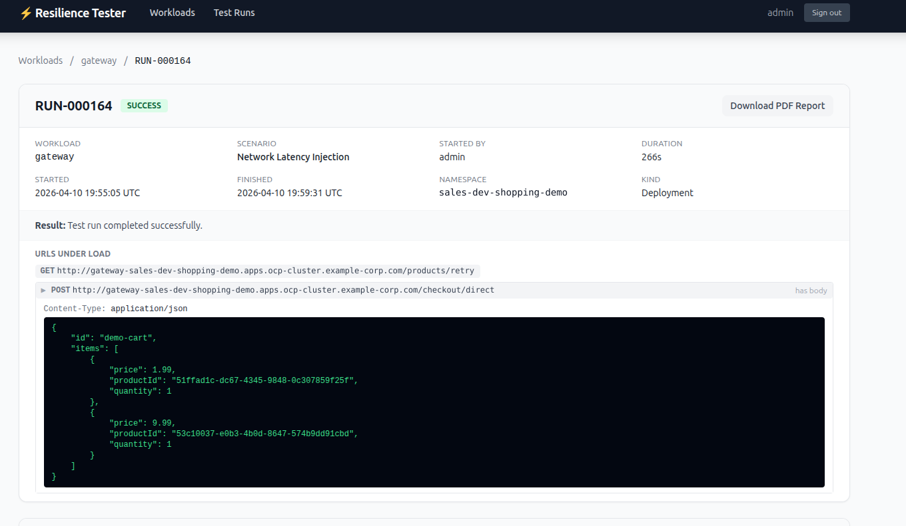
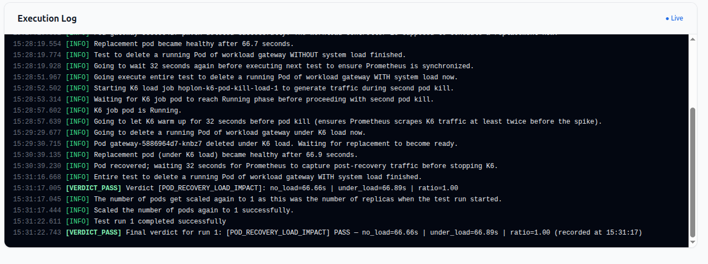
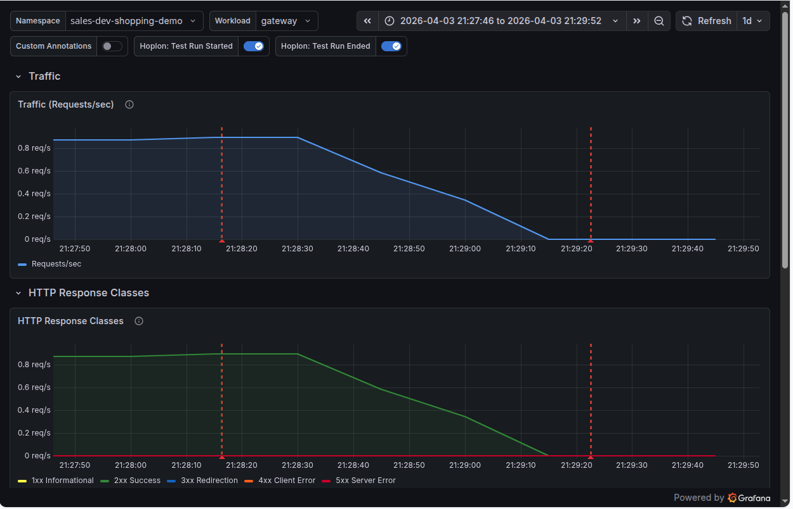
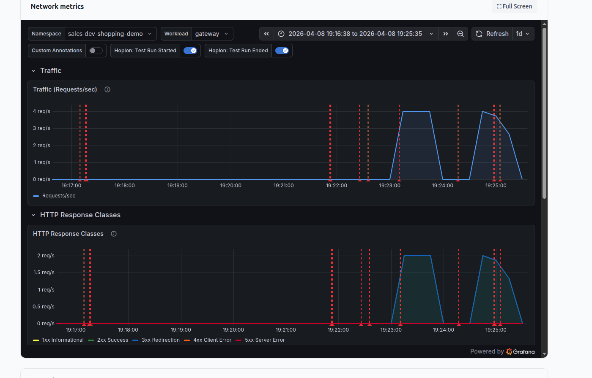

# Safety Automation

**Resilience testing for OpenShift applications — run by the development and QA teams themselves, with audit-ready reports.**

Safety Automation injects controlled failures into running OpenShift workloads (killed pods, slow or failing
HTTP dependencies) while generating realistic load, shows in live charts how the application copes, and finally records the
result as an archival-grade PDF/A report. It is built for developers, QA teams and platform engineers in
regulated environments such as banking, where resilience must be demonstrated and documented — not just
assumed.

> **Project status: on hold.** This repository is currently not under active development. The product is
> not finished — the open items are listed under [Roadmap](#roadmap) — and what is here is a working
> pre-release (v0.1.x), not a final version.
>
> Source available for viewing and reference (see [License](#license)).



## What makes it different

- **No elevated privileges.** Runs entirely inside one namespace with a namespaced `Role` — no `ClusterRole`,
  no operator, no root (`runAsNonRoot`, no privilege escalation, OpenShift restricted SCC). Typical chaos
  engineering tools need cluster-wide rights, which large organisations rarely grant.
- **Self-service.** Installed with a Helm chart by the team that owns the application — no SRE or cluster
  admin involvement needed.
- **Scenarios work out of the box.** Pick a workload, enter the URLs to load-test, choose a scenario. No test
  code to write.
- **Audit-ready reports.** Every run produces a PDF/A-1b report (archival ISO standard) with run metadata,
  the complete log and the findings — produced by a PDF/A encoder written from scratch in Go, with embedded
  fonts and ICC colour profile.
- **Live observability.** A bundled Grafana dashboard (Istio golden signals: traffic, latency, errors) is
  embedded in each test run and annotated at every fault event; the execution log streams live to the browser.
- **Made for development and staging namespaces** — not for production.

## Scenarios

| Scenario | What it does |
|---|---|
| **Pod Kill and Start** | Deletes pods of the target workload under continuous K6 load and measures recovery time and client-visible errors. |
| **HTTP Dependency Delay** | Discovers the workload's outbound HTTP dependencies from Istio metrics, then injects latency on all of them via Istio VirtualServices. |
| **HTTP Dependency Error** | Same discovery, but injects HTTP 503 errors on 50 % of requests — tests circuit breakers and fallbacks. |
| Resource Stress | Planned (currently a stub). |

## Screenshots

**Live execution log** of a *Pod Kill and Start* run — pod kills without and under K6 load, recovery times,
and an automatically computed verdict:



**Embedded Grafana dashboard** — Istio traffic and HTTP response classes of the workload under test; the red
dashed lines are annotations Safety Automation writes at every test event:





<sub>Screenshots were taken during development, when the product still ran under its working titles
"Resilience Tester" and "Hoplon"; environment names have been anonymised.</sub>

## Roadmap

Planned but not yet built — on hold together with the rest of the project:

- Support for workloads without Istio
- Report templates for regulatory requirements (e.g. EU DORA)
- Cryptographically signed reports
- Resilience tests for database dependencies (Oracle and others)
- Resource Stress scenario

## Architecture

- Single Go binary (`cmd/server/main.go`), router: Chi v5
- Server-side HTML with htmx partial updates, Tailwind CSS (CDN) — no frontend build step
- Database: Oracle via godror (EZConnect, TNS and mTLS wallet supported)
- OpenShift / Kubernetes: client-go, in-cluster or via kubeconfig
- Load generation: K6 as Kubernetes Jobs; fault injection: Istio VirtualServices
- Test execution: bounded goroutine worker pool with context cancellation
- Live logs: Server-Sent Events (SSE), persisted to the database at the same time
- PDF reports: hand-written PDF/A-1b encoder (no PDF library)
- Grafana: dashboard embedding, run annotations, Prometheus scrape-interval queries
- Deployment: Helm chart (see [`HELM-DEPLOYMENT.md`](HELM-DEPLOYMENT.md))

## Prerequisites

- Go 1.25+
- Oracle Instant Client (required by godror)
- OpenShift cluster with Istio / OpenShift Service Mesh, `oc` CLI logged in
- Grafana with access to the Istio Prometheus
- Oracle wallet (only for mTLS / Oracle Cloud Autonomous Database)

Building the container image additionally requires the Oracle Instant Client *Basic Light* zip in
`resources-embedded/` (see `Dockerfile`). It is not part of this repository because Oracle's license does
not permit redistributing it — download it from oracle.com.

## Quick Start

1. Configure environment:
   ```
   cp .env.example resources-local-development-only/.env
   ```
   Edit the .env with your Oracle DSN and - if using a wallet - the wallet path. Commands `make run` / `make dev` load the
   environment from exactly this file. The file is further excluded by `.gitignore` and never committed.

2. Oracle connection modes:
   - **EZConnect** (no files): `ORACLE_DSN=user/pass@//host:1521/service`
   - **TNS / mTLS wallet**: `ORACLE_DSN=user/pass@alias`, set `TNS_ADMIN` to the wallet directory

3. OpenShift: after `oc login`, run: `oc project your-namespace`

4. Run:
   ```
   make run
   ```

On first start an `admin` user is created with the default password defined in `internal/auth/auth.go` —
change it immediately after the first login.

## Development (Hot Reload)

Install Air once:
```
go install github.com/air-verse/air@latest
```

Run with live reload:
```
make dev
```

## Project Structure

```
cmd/server/main.go                    Entry point
internal/applicationModelStructs/     Shared domain types (Workload, status enums, etc.)
internal/auth/                        Session auth (bcrypt + gorilla/sessions)
internal/backend/database/            Oracle DB + repository layer
internal/backend/grafana/             Grafana HTTP client, DashboardUID constant, OrgID var
internal/backend/prometheus/          Prometheus query helpers (scrape interval, metric queries)
internal/backend/restClient/          client-go wrapper (Deployments, DeploymentConfigs, K6 jobs)
internal/config/                      Environment variable loading
internal/httpHandler/                 HTTP handlers (all share SharedHTTPRequestDependenciesHandlerStruct)
internal/logger/                      Run-scoped DatabaseSSELogger (writes to DB and SSE stream)
internal/pdf/                         Audit report PDF generation
internal/scenarioImplementation/      TestScenario interface + implementations
internal/serverlog/                   In-memory ring buffer for /admin/logs page
internal/testRunExecution/            Worker pool and test run lifecycle management
internal/version/                     Version string
web/templates/                        HTML templates (embedded in binary at build time)
```

## Environment Variables

| Variable | Default | Notes |
|---|---|---|
| `APP_PORT` | `8080` | HTTP listen port |
| `ORACLE_DSN` | — | Required. EZConnect: `user/pass@//host:1521/svc` — TNS: `user/pass@alias` |
| `TNS_ADMIN` | — | Path to wallet/TNS directory. Must be set before process start. Not needed for EZConnect. |
| `KUBECONFIG_PATH` | — | Optional; auto-detects active kubeconfig context otherwise |
| `MAX_PARALLEL_TESTS` | `4` | Max concurrent test runs |
| `K6_IMAGE` | `grafana/k6:latest` | K6 container image used for load test jobs |
| `K6_TIMEOUT_SECONDS` | `300` | Max duration of a K6 job |
| `SESSION_SECRET` | insecure default | Change in production — random 32-byte string |
| `SESSION_ENCRYPT_KEY` | insecure default | Change in production — 16, 24, or 32 bytes, distinct from `SESSION_SECRET` |
| `GRAFANA_URL` | — | Required for Grafana integration. Use HTTPS to avoid mixed-content iframe issues. |
| `GRAFANA_TOKEN` | — | Required. Service account token with Editor permission on the Public Grafana org. |
| `GRAFANA_PROMETHEUS_DATASOURCE_UID` | — | Required. UID of the Istio Prometheus datasource in Grafana. |
| `GRAFANA_SKIP_TLS_VERIFY` | `false` | Disable TLS verification for Grafana requests. Dev only — never in production. |

## Implementing a Scenario

1. Create a struct in `internal/scenarioImplementation/` implementing the `TestScenario` interface from `TestScenario.go`:

   ```go
   type TestScenario interface {
     Run(
       ctx context.Context,
       testRunId int64,
       target applicationModelStructs.Workload,
       urls []database.TestRunURL,
       kubernetesClient *restClient.KubernetesClient,
       db *sql.DB,
       databaseSSELogger *logger.DatabaseSSELogger,
     ) error

     CreateFinalVerdicts(
       ctx context.Context,
       testRunId int64,
       target applicationModelStructs.Workload,
       db *sql.DB,
       sseLogger *logger.DatabaseSSELogger,
     ) error
   }
   ```

2. Register it in the `Registry` map in `internal/scenarioImplementation/TestScenario.go`

3. Add a seed entry in `main.go` (scenario type + any finding types it uses)

## License

Copyright (c) 2024–2026
All rights reserved.

Third-party components keep their own licenses. The files embedded for PDF/A generation in
`resources-embedded/needed-for-pdfa1b-workaround/` are:

- Liberation Mono font — SIL Open Font License 1.1 (`LiberationMono-LICENSE.txt`)
- sRGB2014 ICC profile by the International Color Consortium — free to use and redistribute unmodified
  (`sRGB2014-LICENSE.txt`)

## Contributing

Interested in contributing, or in using Safety Automation? Please get in touch via my GitHub profile.
